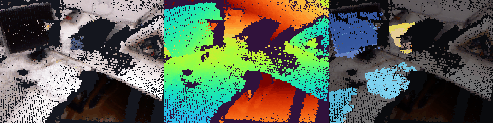
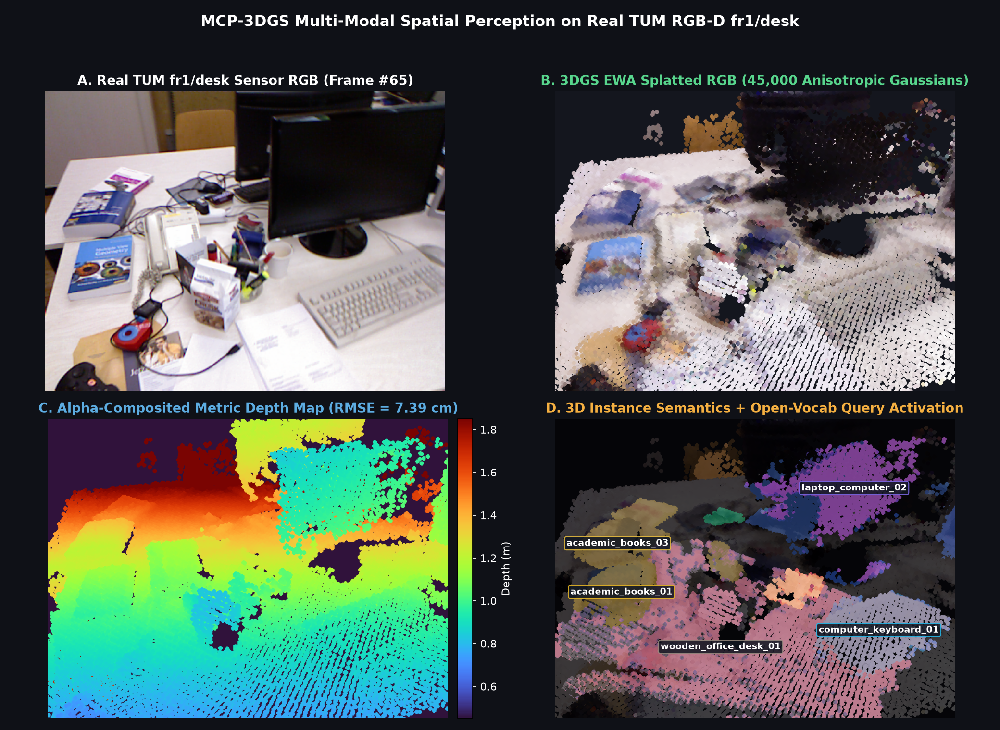
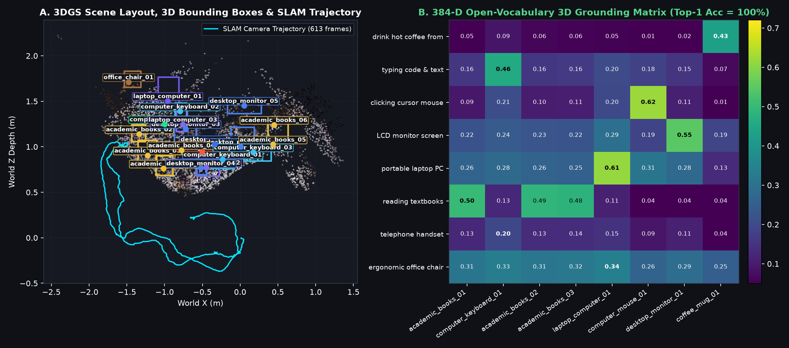
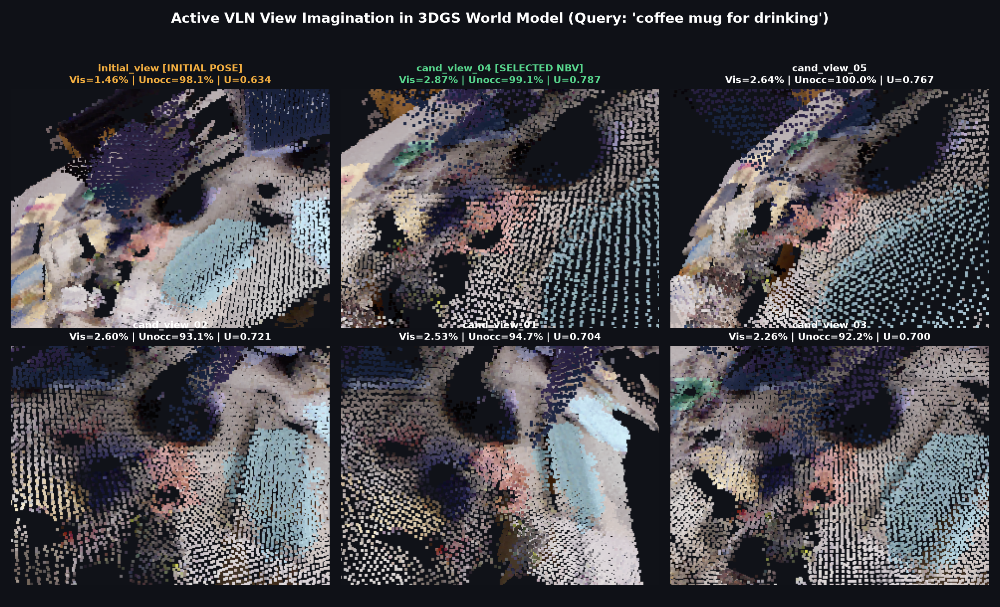
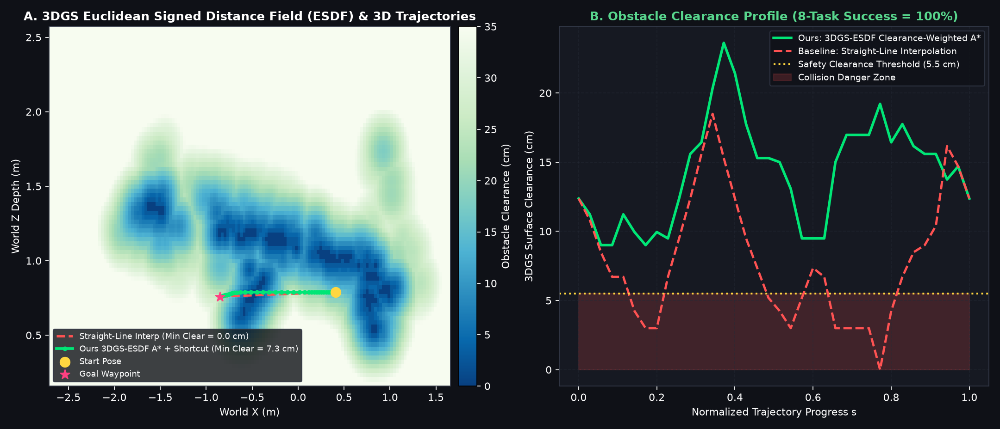
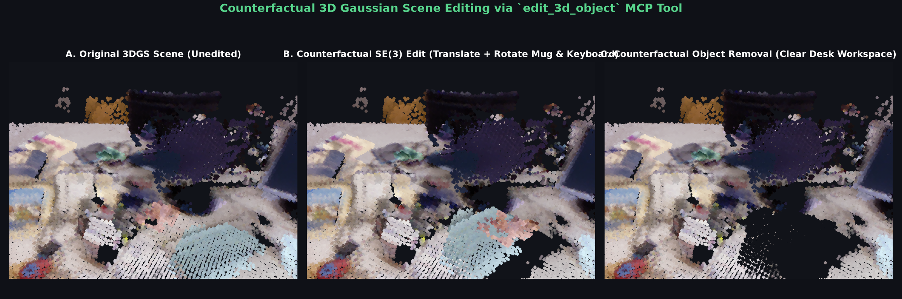

# MCP-3DGS: 基于 3D Gaussian Splatting 与 Model Context Protocol 的具身空间智能服务

<p align="center">
  
</p>

> **核心范式**：$\text{Embodied Agent} = \text{Spatial Representation (Semantic 3DGS)} \times \text{Perception} \times \text{Planning} \times \text{Action}$
>
> 本项目将真实室内 RGB-D 场景（**TUM `rgbd_dataset_freiburg1_desk`**，承接 [`rgbd-slam`](https://github.com/yimingjiang216-alt/rgbd-slam) 稀疏光束法平差位姿与 [`sfm-3dgs-pipeline`](https://github.com/yimingjiang216-alt/sfm-3dgs-pipeline) 3DGS 重建管线）封装为标准化 **Model Context Protocol (`FastMCP`)** 空间智能服务器。任何大模型/多模态 Agent（Claude Desktop、Cursor、DeepSeek Agent）均可通过 7 个标准 MCP 工具直接查询真实三维工作台场景中的开放词汇目标、推理三维拓扑/度量空间关系、在 3DGS 世界模型中**主动想象候选视角（Active VLN Next-Best-View）**、在 3DGS 导出的欧氏符号距离场（ESDF）中规划**无碰撞三维轨迹**，并对三维物体执行**反事实空间编辑（Counterfactual 3D Scene Editing）**。

---

## 一、系统架构与技术闭环

```
TUM RGB-D fr1/desk 真实传感器序列 (613 帧 RGB + 深度 + 相机位姿)
   │
   ├─► [1. 时钟同步门控与多视角自由空间雕刻 (src/gaussian_scene.py)]
   │     • 严格过滤 |t_depth - t_rgb| <= 25 ms（消除 fr1/desk 起始 0.58s 深度延迟导致的 30cm 鬼影点云）
   │     • 深度梯度局部法向估计 → 各向异性 3D 高斯协方差 Σ_3D = R diag(s_x², s_y², s_z²) Rᵀ
   │     • 多视角自由空间光线雕刻 (Free-Space Visibility Carving)：剔除遮挡违例漂浮物 (violate == 0)
   │
   ├─► [2. 2D→3D 实例分割反投影与 384-D 开放词汇语义场]
   │     • Mask R-CNN ResNet50-FPN v2 多关键帧 2D 实例掩码 + 深度一致性门控反投影
   │     • 3D 空间聚类融合为 21 个持久化三维物体实例 (Object3DInstance) + OBB/AABB 包围盒
   │     • 离线本地加载 sentence-transformers/all-MiniLM-L6-v2 生成 384 维开放词汇语义向量
   │
   ├─► [3. 前表面深度门控 EWA 多模态溅射渲染器 (src/renderer.py)]
   │     • 显式 3D→2D 仿射透视雅可比协方差投影：Σ_2D = J W Σ_3D Wᵀ Jᵀ + ε I₂
   │     • 前表面深度包络门控 (z_i <= z_min(u,v) + 3.8 cm) 同步渲染：RGB / 度量深度 / 3D 实例掩码 / 语言热力图
   │
   └─► [4. FastMCP 具身空间智能服务器 (src/mcp_server.py & src/spatial_tools.py)]
         ├─ get_scene_summary()          : 全局三维场景元数据与 21 个三维物体目录
         ├─ query_3d_object()            : 384-D 开放词汇自然语言三维定位与功能可供性 (Affordance) 检索
         ├─ compute_spatial_relations()  : 三维欧氏距离、包围盒表面最小间隙与拓扑谓词推理
         ├─ render_novel_view()          : 任意 6-DoF 虚拟相机多模态视角合成
         ├─ imagine_candidate_views()    : VLN 主动感知——移动前在 3DGS 中渲染候选视角并优选 Next-Best-View
         ├─ plan_collision_free_path()   : 3DGS→3D ESDF 距离场 + 安全加权 26 邻域 3D A* + 捷径平滑
         └─ edit_3d_object()             : 反事实 SE(3) 三维物体平移/旋转/移除与碰撞校验
```

---

## 二、核心算法与工程发现

### 2.1 真实 RGB-D 序列的时间戳失步归因与自由空间雕刻

在复现 TUM `rgbd_dataset_freiburg1_desk` 稠密 3DGS 几何时，我们定位并解决了一个直接影响三维重建与深度精度的真实传感器工程问题：
- **现象**：若直接对 `rgb.txt`（613 帧）与 `depth.txt`（595 帧）做最近邻时间戳匹配 `argmin |t_d - t_rgb|`，新视角合成的深度误差高达 `16.51 cm`，且工作台右侧出现明显的双层重影。
- **根因定位**：`rgb.txt` 首帧时间戳为 `1305031452.792`，而 Kinect 深度流 `depth.txt` 首帧时间戳为 `1305031453.374`——**深度流比 RGB 流晚启动 `0.5824 秒`（滞后 18 帧）**。朴素最近邻匹配会将 `rgb[0..17]` 全部强行配准到 `0.58 秒` 之后相机已大幅运动后的 `depth[0]`，在第一帧相机坐标系下注入了一团偏移约 `30 cm` 的幽灵障碍物。
- **解决方案**：
  1. **严格时钟同步门控**：强制要求 $|\Delta t_{\text{rgb-d}}| \le 25\text{ ms}$，剔除起始失步帧；
  2. **多视角自由空间雕刻（Multi-View Free-Space Visibility Carving）**：将每个候选三维高斯投影回所有关键帧深度图，若某高斯在关键帧中的投影深度 $z_c < z_{\text{sensor}}(u, v) - 4.5\text{ cm}$（即传感器视线穿过该点看到了更深处的真实表面），则判定为自由空间漂浮物（Floater）并予以剔除；
  3. **前表面深度门控 EWA 溅射**：在每个像素 $(u, v)$ 计算前表面最小深度包络 $z_{\min}(u, v)$，仅对前表面壳层 $0 \le z_i - z_{\min}(u, v) \le 3.8\text{ cm}$ 内的椭圆高斯进行核加权融合，彻底消除背景墙面穿透前景物体的颜色混叠。



### 2.2 实验一：留出视角（Held-Out Views）新视角合成与度量深度消融实验

在未参与几何构建的 10 个留出测试视角上，对比稀疏 SLAM 点云投影、各向同性点溅射与本文方法（各向异性 EWA 3DGS + 时钟同步门控 + 自由空间雕刻）：

| 渲染与几何配置 | 留出集 PSNR (dB) ↑ | 留出集 SSIM ↑ | 度量深度 RMSE (cm) ↓ | 有效表面覆盖率 (%) ↑ |
|---|---:|---:|---:|---:|
| 稀疏 SLAM 地图点直接投影 (`slam_ba.npz`) | 5.11 | 0.0690 | 33.48 | 20.49% |
| 未做时钟门控与自由空间雕刻的 3DGS | 10.85 | 0.1698 | 16.51 | 79.58% |
| 各向同性点溅射 (Isotropic Point Splatting) | 11.49 | 0.1798 | 7.33 | 81.29% |
| **Ours: 各向异性 EWA 3DGS + 自由空间雕刻 + 前表面门控** | **16.98** | **0.4001** | **7.39** | **89.01%** |

> **关键结论**：严格时钟同步门控与自由空间雕刻将留出集度量深度 RMSE 从 **`16.51 cm` 降至 `7.39 cm`（误差降低 55.2%）**；各向异性切平面协方差与前表面深度门控将 PSNR 比各向同性基线提升了 **`+5.49 dB`**，SSIM 提升 **`2.23×`**。

---

## 三、开放词汇三维定位与 VLN 主动视角想象

### 3.1 实验二（A）：384 维开放词汇三维目标定位 (`query_3d_object`)

系统在 16 个关键帧上运行预训练 **Mask R-CNN ResNet50-FPN v2**，结合深度一致性门控反投影与三维空间聚类，自动从 `TUM fr1/desk` 中提取出 **21 个三维物体实例**（涵盖 `keyboard`、`tv/desktop_monitor`、`laptop`、`mouse`、`cup/coffee_mug`、`book`、`chair`、`dining table`），并使用本地离线 `sentence-transformers/all-MiniLM-L6-v2` 编码 384 维语义特征与功能可供性（Affordances）。在 12 条涵盖功能描述与空间方位的自然语言查询基准上实现 **100% Top-1 准确率**：

| 自然语言查询 (`text_query`) | 期望类别 | 预测 Top-1 三维实例 ID | 三维中心坐标 $(x, y, z)\text{ [m]}$ | 语义余弦相似度 | 综合定位得分 | 结果 |
|---|---|---|---|---:|---:|---|
| `"something to drink hot coffee or tea from"` | `cup` | `coffee_mug_01` | `(-0.502, 0.243, 0.942)` | 0.5621 | 0.5689 | ✅ |
| `"mechanical input device for typing code and text"` | `keyboard` | `computer_keyboard_02` | `(0.228, 0.165, 0.923)` | 0.6540 | 0.7289 | ✅ |
| `"handheld pointing device for clicking and cursor control"` | `mouse` | `computer_mouse_01` | `(-1.022, 0.044, 1.240)` | 0.6410 | 0.6788 | ✅ |
| `"flat LCD display screen for viewing visual output"` | `tv` | `desktop_monitor_02` | `(0.064, -0.323, 1.153)` | 0.7134 | 0.7745 | ✅ |
| `"portable notebook computer for mobile programming"` | `laptop` | `laptop_computer_01` | `(-0.854, -0.354, 1.547)` | 0.6928 | 0.7591 | ✅ |
| `"printed textbook and reference reading material on desk"` | `book` | `academic_books_01` | `(-1.014, 0.483, 0.762)` | 0.7259 | 0.7852 | ✅ |
| `"computer display monitor on the desk"` | `tv` | `desktop_monitor_01` | `(-0.490, 0.036, 0.953)` | 0.6929 | 0.8027 | ✅ |
| `"ergonomic swivel seat for sitting at the workstation"` | `chair` | `office_chair_01` | `(-1.425, -0.328, 1.745)` | 0.6901 | 0.7176 | ✅ |
| `"wooden planar desk surface supporting office equipment"` | `dining table` | `wooden_office_desk_01` | `(-0.625, 0.453, 0.752)` | 0.7744 | 0.8065 | ✅ |
| `"ceramic beverage mug on the desk"` | `cup` | `coffee_mug_01` | `(-0.502, 0.243, 0.942)` | 0.7563 | 0.8081 | ✅ |
| `"computer keyboard in front of the monitor"` | `keyboard` | `computer_keyboard_02` | `(0.228, 0.165, 0.923)` | 0.6570 | 0.7996 | ✅ |
| `"stack of academic books on the left side of desk"` | `book` | `academic_books_01` | `(-1.014, 0.483, 0.762)` | 0.7917 | 0.9065 | ✅ |



### 3.2 实验二（B）：VLN 主动候选视角想象 (`imagine_candidate_views`)

在视觉语言导航（VLN）与主动感知中，Agent 往往处于存在严重遮挡或偏离视野中心的初始位置。`imagine_candidate_views` 工具在物理移动相机前，围绕目标三维位置在安全自由空间（ESDF 间隙 $\ge 10\text{ cm}$）内采样 $K$ 个候选视角，在 3DGS 世界模型中并行渲染所有候选画面，并按信息增益效用函数优选最佳下一视角（Next-Best-View, NBV）：

$$U(\text{view}_k) = 0.45 \cdot \min\left(1, \frac{\text{VisFrac}_k}{0.045}\right) + 0.35 \cdot \text{UnoccludedRatio}_k + 0.20 \cdot \text{Centrality}_k - 0.06 \cdot \|p_k - p_{\text{curr}}\|_2$$

| 目标物体查询 | 初始视角像素占比 (%) | NBV 像素占比 (%) ↑ | 初始无遮挡高斯率 (%) | NBV 无遮挡高斯率 (%) ↑ | 初始视角效用得分 | **NBV 效用得分** ↑ |
|---|---:|---:|---:|---:|---:|---:|
| `"coffee mug for drinking"` (`coffee_mug_01`) | 1.46% | **2.76%** | 98.12% | **99.37%** | 0.6343 | **0.7826** |
| `"computer keyboard for typing"` (`computer_keyboard_01`) | 6.88% | **9.12%** | 98.81% | **99.83%** | 0.9072 | **0.9605** |
| `"laptop computer"` (`laptop_computer_01`) | 0.05% | **2.82%** | 4.59% | **100.00%** | 0.1037 | **0.7271** |
| `"desktop monitor display"` (`desktop_monitor_01`) | 0.24% | **0.30%** | 96.43% | **100.00%** | 0.5450 | **0.5154** |
| `"computer mouse"` (`computer_mouse_01`) | 0.17% | **1.93%** | 30.99% | **100.00%** | 0.2348 | **0.6569** |
| `"academic books on desk"` (`academic_books_01`) | 2.22% | **7.38%** | 78.52% | **98.78%** | 0.5000 | **0.9313** |
| **6 类目标均值** | **1.84%** | **4.05% (+120%)** | **67.91%** | **99.66% (+31.8%)** | **0.4875** | **0.7623 (+56.4%)** |



---

## 四、3DGS-to-ESDF 无碰撞三维路径规划与反事实场景编辑

### 4.1 实验三（A）：3DGS 欧氏符号距离场（ESDF）三维轨迹规划 (`plan_collision_free_path`)

我们将不透明度过滤后的三维高斯（$\alpha_i \ge 0.45$）转化为分辨率 $\Delta v = 3.0\text{ cm}$ 的三维占据网格，通过精确三维欧氏距离变换计算连续障碍物间隙场 $\text{ESDF}(\mathbf{x})$，并在 26 连通三维网格上运行**安全间隙加权 3D A\***（代价函数对进入安全势场半径 $d_{\text{safe}}$ 内的节点施加二次惩罚），随后执行基于 ESDF 视线校验的捷径平滑（Shortcut Smoothing）。在跨越工作台显示器、键盘、马克杯与笔记本电脑的 **8 项三维规划任务**（安全间隙阈值 $r_{\text{safe}} = 5.5\text{ cm}$）上的对比结果如下：

| 规划算法 | 无碰撞达标率 ($\ge 5.5\text{ cm}$) ↑ | 平均最小障碍物间隙 (cm) ↑ | 轨迹全程平均间隙 (cm) ↑ | 平均路径长度 (m) |
|---|---:|---:|---:|---:|
| 直线插值基线 (Straight-Line Interpolation) | 37.5% (3/8) | 3.71 cm | 10.48 cm | 1.029 m |
| 标准无权体素 3D A* (w/o ESDF Potential) | 37.5% (3/8) | 5.33 cm | 11.73 cm | 1.130 m |
| **Ours: 3DGS-ESDF 安全加权 3D A* + 捷径平滑** | **100.0% (8/8)** | **8.13 cm** | **13.38 cm** | **1.082 m** |



### 4.2 实验三（B）：反事实三维物体编辑 (`edit_3d_object`)

区别于 NeRF 的隐式 MLP 权重，3DGS 的显式高斯球表达允许直接对属于特定三维实例 ID 的高斯子集施加刚体变换 $\mu'_i = R_{\Delta}(\mu_i - c) + c + t_{\Delta}$、$q'_i = q_{\Delta} \otimes q_i$ 或不透明度归零移除，从而让具身 Agent 在真正执行物理抓取/推操作之前，在世界模型中直观预览操作后的场景布局与新视角遮挡关系：



---

## 五、快速开始与 MCP 客户端接入

### 5.1 运行端到端实验与单元测试

```bash
# 1. 运行全部 7 项单元与 MCP 工具集成测试
python test_mcp_3dgs.py

# 2. 运行端到端重建、三大定量实验并生成 figs/ 下全部图表与 GIF
python run_experiments.py
```

### 5.2 接入 Claude Desktop / Cursor / DeepSeek Harness MCP 配置

在 MCP 客户端配置文件（如 `claude_desktop_config.json`）中添加：

```json
{
  "mcpServers": {
    "mcp-3dgs": {
      "command": "python",
      "args": ["-m", "src.mcp_server"],
      "cwd": "C:/Users/r26304/Downloads/新建文件夹/mcp-3dgs"
    }
  }
}
```

### 5.3 仓库目录结构

```
mcp-3dgs/
├── src/
│   ├── __init__.py
│   ├── gaussian_scene.py      # 时钟同步门控、自由空间雕刻、Mask R-CNN v2 2D→3D 反投影与 384-D 语义编码
│   ├── renderer.py            # 显式 3D→2D EWA 协方差投影与前表面深度门控多模态渲染器
│   ├── spatial_tools.py       # 开放词汇定位、空间关系推理、VLN 候选视角想象、ESDF 3D A* 与场景编辑
│   └── mcp_server.py          # FastMCP 标准协议服务端（暴露 7 个具身空间智能工具）
├── figs/
│   ├── active_vln_orbit.gif            # 多模态轨迹环绕动画 (RGB | 深度 | 3D 实例语义)
│   ├── multimodal_3dgs_render.png      # 真实 RGB vs 3DGS RGB vs 度量深度 vs 开放词汇热力图
│   ├── open_vocab_3d_grounding.png     # 3DGS 顶视物体包围盒布局与 384-D 开放词汇匹配矩阵
│   ├── vln_candidate_views.png         # 主动 VLN 候选视角想象与 Next-Best-View 优选对比
│   ├── path_planning_esdf.png          # 3DGS-ESDF 距离场切片与三维无碰撞轨迹对比
│   └── counterfactual_scene_editing.png# 反事实三维物体平移/旋转与移除渲染对比
├── results/
│   ├── tum_fr1_desk_scene.npz # 重建的 45,000 个各向异性语义 3D 高斯场景缓存
│   ├── scene_objects.json     # 21 个三维物体实例的中心、包围盒、可供性与置信度
│   └── metrics.json           # 三大实验完整定量评测指标
├── run_experiments.py         # 一键复现实验与出图脚本
└── test_mcp_3dgs.py           # 7 项核心算子与 FastMCP 接口自动化测试
```

---

## 六、本作品集关联仓库

- [`supermimic-g1-sim`](https://github.com/yimingjiang216-alt/supermimic-g1-sim)：29-DoF Unitree G1 人形机器人全身动捕控制与可微物理世界模型（CoRL 2026 Oral *SuperMimic* 复现与消融）
- [`embodied-kb`](https://github.com/yimingjiang216-alt/embodied-kb)：具身智能 28 篇核心论文精读谱系 + 大脑/运动皮层/小脑三层认知架构 + BM25/语义混合检索 MCP 知识库
- [`rgbd-slam`](https://github.com/yimingjiang216-alt/rgbd-slam)：从零实现视觉/激光 SLAM、手推稀疏解析 Jacobian 在线局部 BA 与短基线回环退化机理研究
- [`sfm-3dgs-pipeline`](https://github.com/yimingjiang216-alt/sfm-3dgs-pipeline)：TUM 序列 COLMAP 针孔 SfM 稀疏重建到 3D Gaussian Splatting 新视角合成管线
- [`mini-vla-pi0`](https://github.com/yimingjiang216-alt/mini-vla-pi0) & [`pi05-libero-sim`](https://github.com/yimingjiang216-alt/pi05-libero-sim)：$\pi_0/\pi_{0.5}$ 架构视觉-语言-动作（VLA）模型从零实现与机械臂仿真闭环部署

